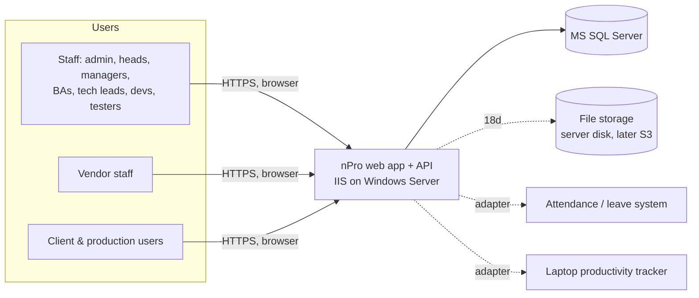

# High-Level Design (HLD)

| | |
|---|---|
| Document ID | NPRO-HLD-001 |
| Version | 1.0 (draft) · 27 Nov 2026 |
| Related | SRS · LLD NPRO-LLD-001 · Solution Architecture NPRO-SA-001 |

## 1. Context

## 2. Building blocks

| Block | Technology | Responsibility |
|---|---|---|
| Web client (SPA) | Angular 22, TypeScript, Tailwind CSS 4, Angular CDK | All screens; local business logic (forms, calculations, history entries); keeps an in-memory copy of everything the person may see |
| API | ASP.NET Core minimal APIs on .NET 10 | Sign-in, access scope, state snapshot, change sync with authorisation, ticket numbering, automation, version feed |
| Rule engine | C# (`Npro.Infrastructure/Rules`) | Automation triggers / conditions / actions, SLA clocks, timed rules |
| Background service | `TimedRulesService` (hosted service) | SLA at-risk / breached and due-date rules every minute |
| Data | EF Core 10 + SQL Server | Entities, migrations, Identity tables |
| Offline demo | Browser localStorage + IndexedDB | Full app with demo data when no API is found |

## 3. Key design decisions

| # | Decision | Reason |
|---|---|---|
| D1 | Single-page app + JSON API, same origin under one IIS site | No CORS; cookies with SameSite=Strict; one deployment unit |
| D2 | **Snapshot + change sync**: load all visible data at sign-in, send changed records after each action | Kept every screen and store method unchanged when moving from browser storage to the server; fast UI |
| D3 | Server authorises **every changed record** against role and scope; batches are all-or-nothing | Security can't depend on the browser |
| D4 | Server owns ticket numbers and runs automation; returns what it changed | Consistency between users; no duplicate rule runs |
| D5 | Polling a version number every 30 s for live updates | Simple, works through IIS and proxies; WebSockets can come later |
| D6 | String ids and lower_snake values identical to the frontend model | API returns exactly what the UI uses |
| D7 | Cookie authentication (ASP.NET Core Identity) | Browser-only clients; HttpOnly cookie safer than tokens in JS |
| D8 | JSON columns for nested data (workflow statuses, rule conditions, labels, custom fields) | Mirrors the domain model; fewer tables |

## 4. Main flows

1. **Start-up**: SPA calls `/api/auth/me` → signed in: `/api/state` → hydrate store; 401 → login page; no API → offline demo.
2. **Change**: user action updates the store → diff → `POST /api/sync` → server checks, saves, numbers tickets, runs rules →
   returns `{version, changes}` → store merges.
3. **Timed rules**: every minute the background service checks SLA / due-date rules and saves results; version moves; browsers
   reload within 30 s.

## 5. Quality attributes
Security (see Security Architecture), accessibility (WCAG 2.2 AA), performance (read p50 16–90 ms locally), maintainability
(typed code, 99 automated tests), portability (IIS / SQL Server).
