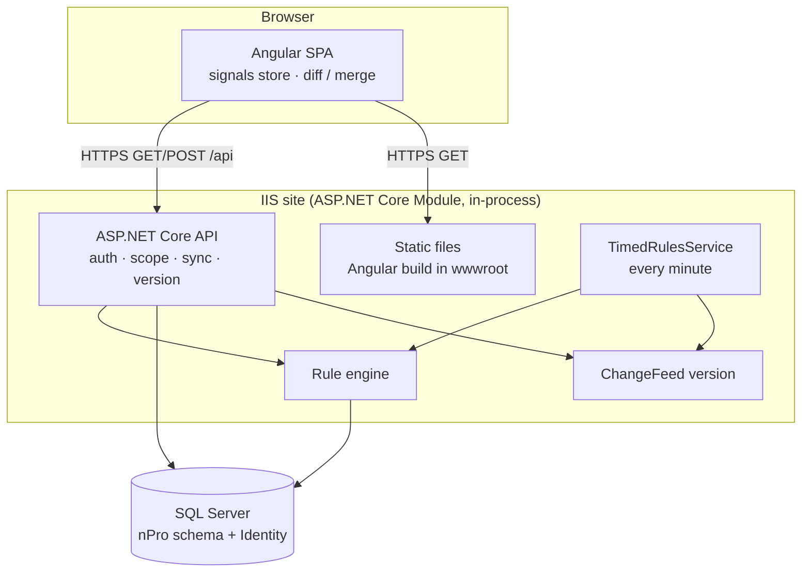

# Solution Architecture Document

| | |
|---|---|
| Document ID | NPRO-SA-001 |
| Version | 1.0 (draft) · 27 Nov 2026 |

## 1. Architecture overview

## 2. Architectural style
Modular monolith: one deployable (API + static files) with clear projects (Domain, Infrastructure, Api). The client is a rich SPA
that owns presentation and much of the interaction logic; the server is the system of record and the authority for access,
numbering and automation.

## 3. Technology stack

| Layer | Choice | Version |
|---|---|---|
| UI framework | Angular (standalone components, signals, zoneless) | 22.3 |
| Language | TypeScript | 6.0 |
| Styling | Tailwind CSS | 4.3 |
| UI utilities | Angular CDK (drag-drop, a11y focus trap), lucide icons | 22.3 / 1.80 |
| Tests (UI) | Vitest + jsdom; axe-core accessibility scan | 5.1 / 4.14 |
| Runtime / API | ASP.NET Core on .NET 10 (LTS) | SDK 10.0.404 |
| Data access | EF Core SQL Server | 10.0.15 |
| Identity | ASP.NET Core Identity (EF stores) | 10.0.15 |
| Database | MS SQL Server (Express in dev; Standard / RDS recommended in production) | 2022 |
| Hosting | IIS 10 on Windows Server (AWS EC2 target) | — |
| Tests (API) | xUnit, WebApplicationFactory, SQLite in-memory | 2.9 / 10.0 |

## 4. Cross-cutting concerns

| Concern | Approach |
|---|---|
| Security | Identity cookie auth, XSRF middleware, server-side scope on every read and write, lockout, problem details without internals |
| Accessibility | WCAG 2.2 AA, axe scan script in the repo |
| Observability | ASP.NET Core logging (console / IIS stdout); health endpoint; recommended: CloudWatch agent |
| Configuration | `appsettings.json` + environment (`ConnectionStrings__Npro`, `Seed__DemoPassword`, `Features__DemoSwitcher`, `Automation__TimedRules`) |
| Data consistency | Transactions per sync batch; unique keys; server-owned counters |
| Time | All timestamps stored as `datetimeoffset`, sent as UTC ISO strings |

## 5. Evolution
- 18d: file storage abstraction (disk → S3), server-side HR / tracker adapters, IIS deployment kit.
- Later: SSO (OpenID Connect), WebSockets / SignalR for live updates, shared version store for a web farm, server-side reports.
