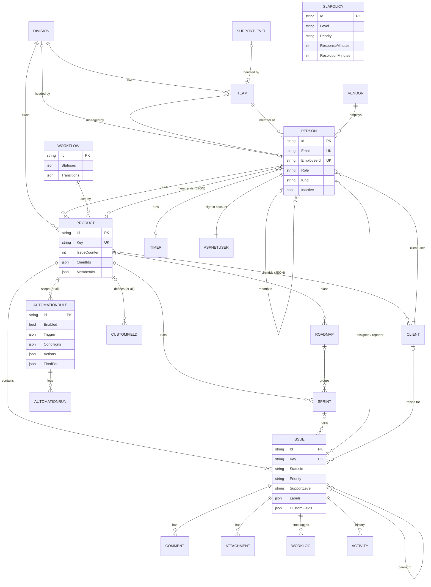

# Entity Relationship Diagram (ERD)

| | |
|---|---|
| Document ID | NPRO-ERD-001 |
| Version | 1.0 (draft) · 27 Nov 2026 |

Relationships are logical (enforced by the API; FK constraints planned). JSON columns are shown as attributes.

Standalone tables: SLAPOLICY (level × priority), SUMMARYNOTE (period key → text), Identity tables (AspNet*).
