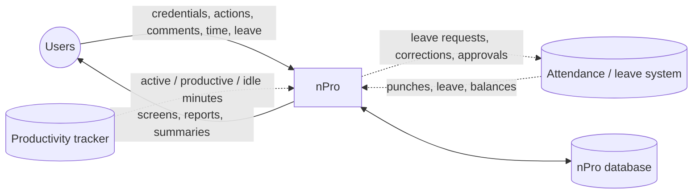
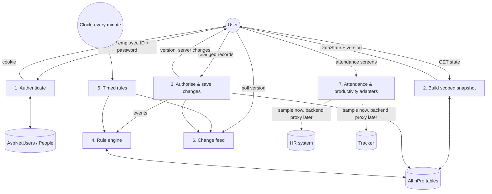

# Data Flow Diagram (DFD)

| | |
|---|---|
| Document ID | NPRO-DFD-001 |
| Version | 1.0 (draft) · 27 Nov 2026 |

## Level 0 — context

## Level 1 — main processes

## Data stores
| Store | Data |
|---|---|
| D1 | Sign-in accounts (password hashes, lockout), people |
| D2 | Organisation, products, tickets, comments, time, history, rules, SLA settings |
| Browser (offline demo only) | localStorage `npro-data`, `npro-integrations`, `npro-ext-sample`; IndexedDB attachment bytes |
| Browser (server mode) | In-memory copy of the snapshot; cookies `npro.auth`, `npro.af`, `XSRF-TOKEN` |

## Trust boundaries
Browser ↔ IIS (TLS); IIS ↔ SQL Server (TLS, Windows / SQL auth); nPro ↔ external systems (server-side, keys in a secret store).
