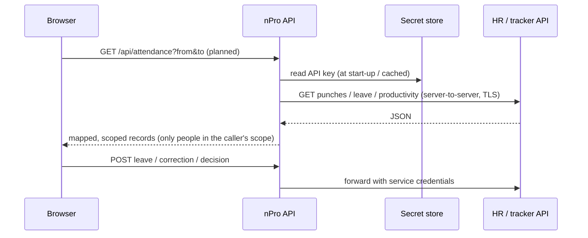

# Integration Design Document

| | |
|---|---|
| Document ID | NPRO-INT-001 |
| Version | 1.0 (draft) · 27 Nov 2026 |
| Status | Adapters built with sample data; live endpoints pending API details |

## 1. Integrations

| System | Direction | Data | Status |
|---|---|---|---|
| Laptop productivity tracker | Inbound | Per person per day: active, productive, idle minutes | Sample adapter |
| Attendance / leave (HR) system | Inbound + outbound | Punch in / out, day status, leave requests + balances, regularisation requests; outbound: apply leave, request correction, approve / reject, withdraw | Sample adapter |
| File storage (S3) | Outbound | Attachment bytes | Planned (18d: server disk first) |
| Identity provider (SSO) | Inbound | Sign-in | Planned |

## 2. Adapter contracts (`src/app/core/external.ts`)

```ts
interface ProductivitySource { days(range, employeeIds): Promise<ProductivityDay[]> }
interface AttendanceSource {
  days(range, ids); leaves(range, ids); regularisations(range, ids); balances(year, ids);
  applyLeave(input); requestRegularisation(input); decide(kind, id, 'approved' | 'rejected', by); cancel(kind, id);
}
```
People are matched by **employee id**: an admin-set code, else the work email (Integrations page). In-house people have an HR
employee ID (EMP-xxx) which should become the default key when the live systems are connected.

## 3. Target design (Phase B, 18d onwards)



Principles: keys never reach the browser; responses filtered by the caller's scope; timeouts (10 s) and retries with back-off;
results cached per day; failures shown as "Couldn't reach the external system" without breaking other screens.

## 4. Error handling and monitoring
Connector cards show last sync time and last error; server logs integration failures; health check will include connector status.

## 5. Information needed to finish
For each system: base URL, authentication method, endpoints and payloads (sample request / response), rate limits, employee
identifier field, time zone handling, test environment.
