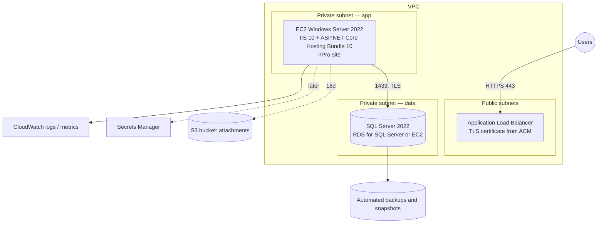

# Infrastructure Architecture Document

| | |
|---|---|
| Document ID | NPRO-INFRA-001 |
| Version | 1.0 (draft) · 27 Nov 2026 |
| Status | Target design — AWS access not yet available |

## 1. Target topology (AWS)

## 2. Components

| Component | Specification (initial) | Notes |
|---|---|---|
| App server | EC2 Windows Server 2022, 2 vCPU / 8 GB (e.g. t3.large / m6i.large) | IIS app pool: No Managed Code, AlwaysRunning, Preload enabled, one worker process |
| Database | SQL Server 2022 Standard (RDS or EC2), 2 vCPU / 8 GB, 100 GB gp3 | Express acceptable only for pilots (10 GB, no TDE) |
| Load balancer | ALB with ACM certificate, HTTP→HTTPS redirect | Health check `GET /api/health` |
| Storage | S3 (18d), versioning + encryption | Until then: `D:\nPro\files` on the app server, included in backups |
| Secrets | Environment variables / IIS config now; Secrets Manager later | Connection string, external API keys |
| Monitoring | CloudWatch agent: IIS logs, app stdout logs, CPU / memory / disk | Alarms: health check failing, CPU > 80 %, disk < 15 % |
| Network | Security groups: ALB 443 from internet; EC2 only from ALB; SQL 1433 only from EC2; RDP via SSM Session Manager | |

## 3. Environments

| Environment | Purpose | Data |
|---|---|---|
| Development | Developer machines: SQL Express, `dotnet run`, `ng serve` with proxy | Demo seed |
| Test / UAT | Same topology at smaller size | Demo seed or masked copy |
| Production | As above | Real data, no demo seed, demo switcher off |

## 4. Scaling and availability
Single app server initially (99.5 % business-hours target). To scale out: move the change-feed version and Data Protection keys
to shared storage, then add EC2 instances behind the ALB; SQL Server Multi-AZ on RDS for database availability.

## 5. Operations
Patching via AWS Systems Manager Patch Manager; deployments by folder copy / Web Deploy (see Deployment Plan); backups per the
Backup and Restore Procedure.
